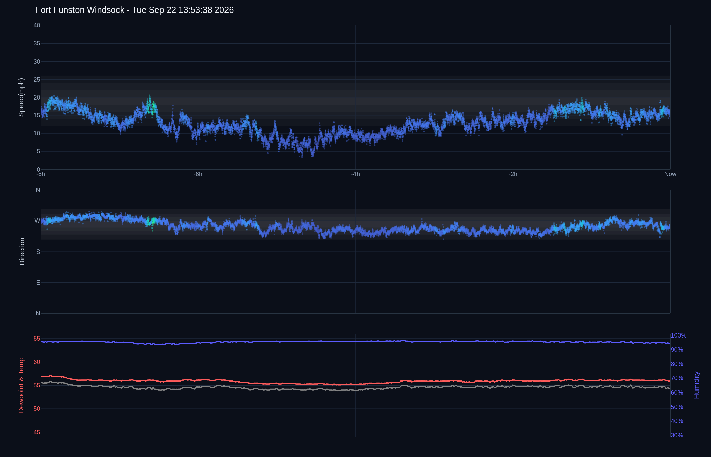
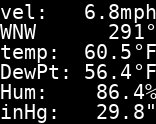

 # gusty, A weather visualization tool

Creates an 8-hour history graph of telemetry gathered from our Davis
Instruments weather stations.



## Dependencies
Definitely do this in a virtual environment
``` 
python3 -m venv .
source bin/activate
python3 -m pip install numpy
python3 -m pip install pillow
python3 -m pip install plotly
python3 -m pip install requests
python3 -m pip install --upgrade 'kaleido>=1'
```

## How it works

Add everything in the system subdirectory to `/etc/systemd/system`. You'll want
to do a `sudo sytemctl enable gusty.target` and `... start gusty.target`

Set up a pair of cronjobs:
```
* * * * * /home/flyfunston/gusty/renderer.sh

57 23 * * * /home/flyfunston/gusty/truncate_and_archive.sh
```

The first component is the listener (listen_on_udp_22222.py,) which picks up
the UDP broadcasts from the Davis base station and queues the data into a pair
of files, one for the windsock and one for the clubhouse. 

The renderer takes the last 8 hours of Davis data and renders various versions
of the above image.

live_overlay.py watches the conditions_windsock.txt file and, every time it
changes, renders one of these:



router.py watches all of the files created by the gusty processes and uploads
them to their final destinations. The .html files are `scp`d to the website and
the .pngs that are consumed by OBS Studio are copied to the directory where
they are consumed.
